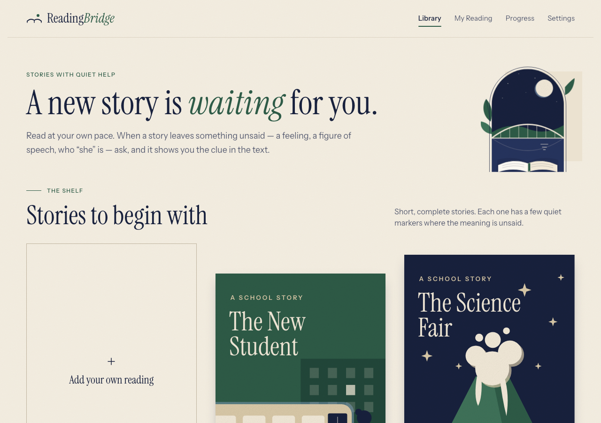

# ReadingBridge

ReadingBridge is a reading app designed with autistic readers in mind: students who read the words
well but can miss what a story implies — a feeling, a figure of speech, who "she" is, or why
something happened. Reading comes first; help appears only when the student asks. They tap a
quiet marker or any sentence and get a short, literal explanation that quotes its evidence from the
story, or an honest "The story doesn't tell us this."

# ReadingBridge

**An AI-powered reading companion that helps readers understand what a story implies, without turning reading into another test.**

## Why I Built It

Reading with my autistic cousin made me notice a problem I hadn't thought much about before. He could read the words in a story, but sometimes the harder part was connecting what those words implied: why a character acted a certain way, what sarcasm meant, or who a pronoun referred to.

I saw how stopping to ask for explanations interrupted the experience. I wanted to build something that gave him more independence while reading, without making him feel like he was constantly being tested.

That's where ReadingBridge began.

I built it around a simple idea: **let the story come first, and offer help only when the reader wants it.**

---

## What ReadingBridge Does

- **Context-aware explanations:** Helps readers understand implied feelings, sarcasm, figurative language, and connections between sentences.
- **Interactive reading:** Readers can tap a suggested marker or select a sentence to request an explanation.
- **Evidence-based responses:** The app shows a supporting quote directly from the passage instead of presenting an explanation without context.
- **Bring your own reading:** Supports original stories, pasted passages, `.txt` files, and text-based PDFs.
- **Personalized experience:** Includes reading progress, bookmarks, and saved readings in the browser.

---

## The Engineering Challenge

Generating an explanation with an AI model is relatively easy. Making sure that explanation is actually supported by the story is harder.

I implemented a **FastAPI backend** that prepares passages, identifies sentences requiring inference, and requests explanations from the **OpenAI API**.

I also added validation checks to verify that supporting quotations appear in the original passage and that the model's responses follow specific constraints.

The goal was to make explanations useful without encouraging the model to invent missing information.

---

## Testing and Evaluation

I tested ReadingBridge using **30 hand-written explanation cases** and **five passages for marker placement**. The cases included sarcasm, implied emotions, ambiguous pronouns, missing information, and figurative language.

### Evaluation Results

| Metric | Result |
|---|---|
| Explanation grounding checks | 30/30 passed on first attempt |
| Development cases — answerability | 17/20 correct (85%) |
| Holdout cases — answerability | 8/10 correct (80%) |
| Evidence selection | Identified as an area for improvement |

Evidence selection remained a weakness, showing that a technically valid answer is not always the most helpful one.

> **Note:** These results come from a small evaluation set rather than a large-scale user study.

---

## What I Learned

One of the most interesting failures involved the sentence:

> "Ben and Sam raced their bikes to the corner shop. He got there first."

The model confidently identified Ben as the person who arrived first, even though the passage never established that.

That changed how I thought about the project. It wasn't enough for an answer to sound reasonable. For a reading assistant, an unsupported explanation can introduce the very confusion the tool is supposed to resolve.

**Improving how the system handles uncertainty remains one of my main priorities.**

---

## Tech Stack

| Component | Technologies |
|---|---|
| Frontend | React, TypeScript, Vite, Tailwind CSS |
| Backend | Python, FastAPI, Pydantic |
| AI | OpenAI API, GPT-4o mini |
| Testing | pytest, Vitest, React Testing Library |
| Document Processing | pypdf |

---

## Current Limitations

ReadingBridge is a prototype, not a clinically validated reading intervention.

- **Scanned documents:** OCR for scanned PDFs is not currently supported.
- **Local storage:** Reading progress is stored locally rather than synced across devices.
- **Ambiguity:** The system needs stronger detection of ambiguous references.
- **Evidence selection:** Supporting quotes are not always the most informative ones.
- **Privacy and accessibility:** A real deployment for children would require additional privacy, consent, and accessibility safeguards.

---

## What's Next

I want to:

1. Improve the model's ability to recognize when a passage does not contain enough information.
2. Strengthen the evidence-selection process.
3. Improve handling of ambiguous references and unsupported inferences.
4. Eventually evaluate the reading experience with users through an appropriate consent-based process.

My goal is to build a tool that helps someone continue reading with greater independence, not simply another interface that generates AI responses.

---

## Author

**Perci Wolday**

- [GitHub](https://github.com/PerciErmiasWolday)
- [LinkedIn](https://www.linkedin.com/in/PerciWolday)

---

*Built with the belief that technology should help people understand more, not make them feel less capable.*
