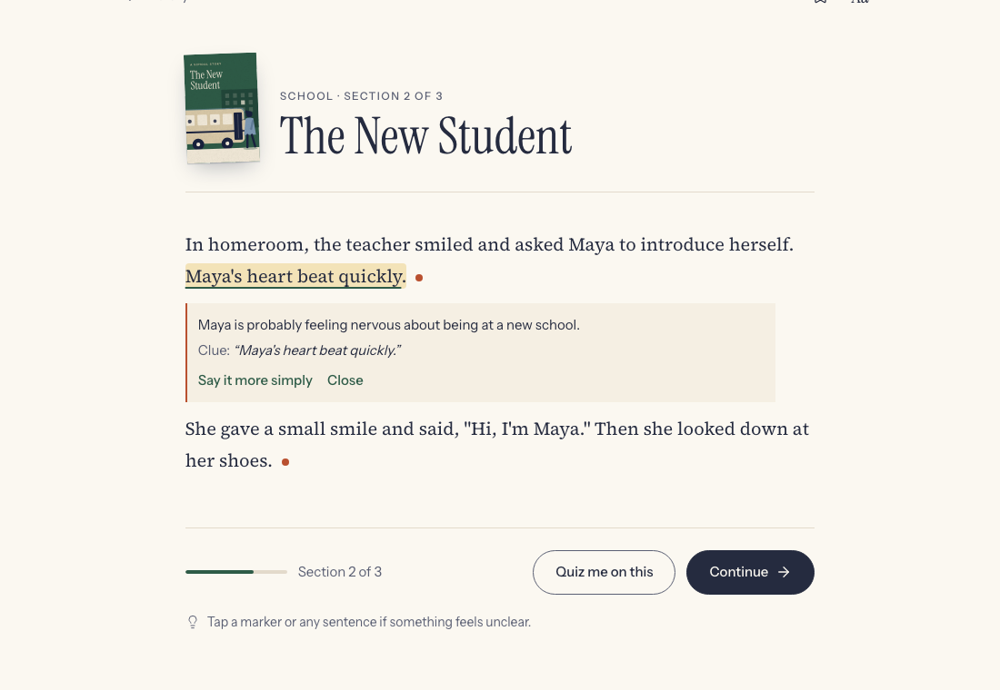
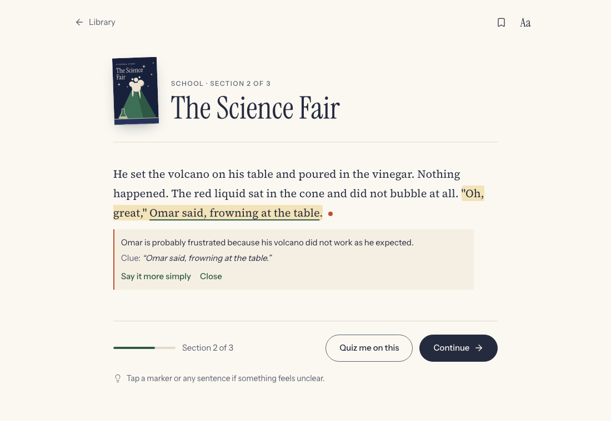
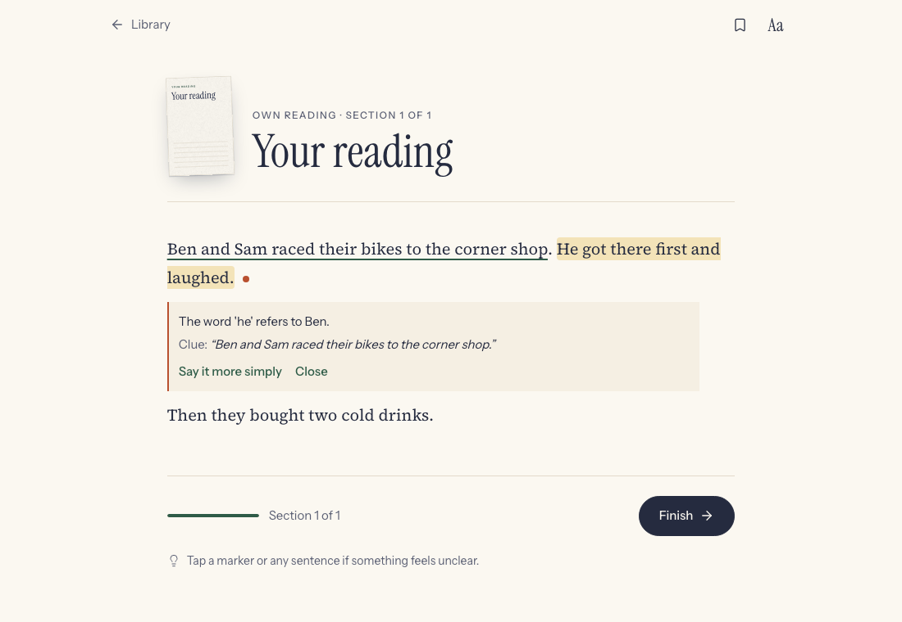
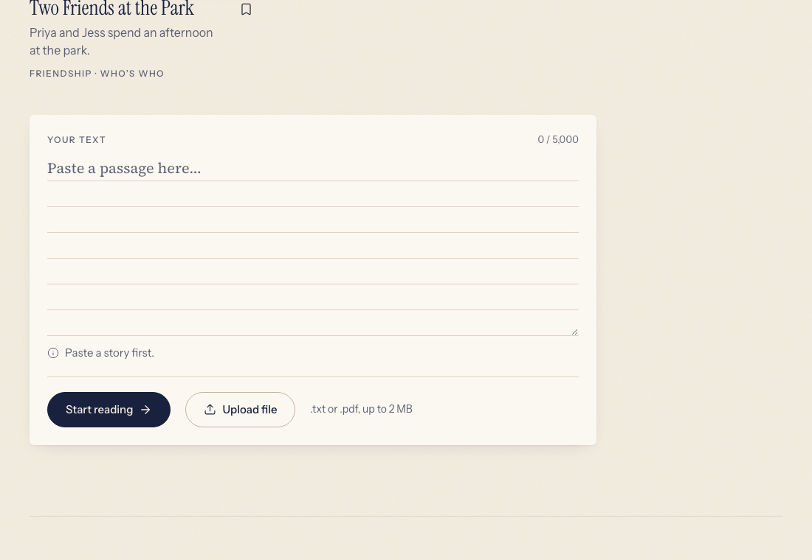
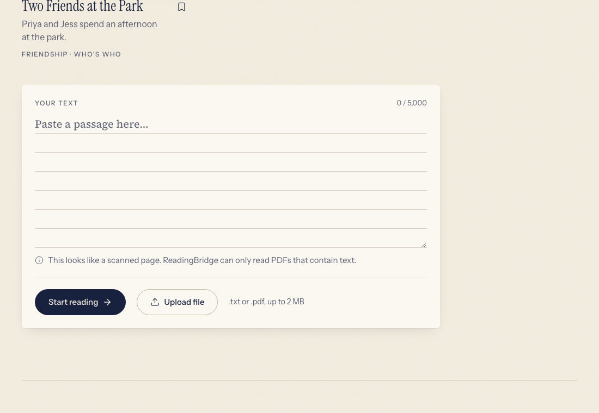

# Test results: three case-study tests

Run on 10 October 2026 in the real app (Chrome, 1100 × 760) with the Phase 6b code and the final
prompt, against the real model (`gpt-4o-mini`). Screenshots are in `docs/screenshots/`. Model answers
can vary slightly between runs; the text below is what this run produced.

## 1. Normal input

| | |
|---|---|
| **Input** | *The New Student*, section 2. The student clicks the marker after "Maya's heart beat quickly." |
| **Expected** | A card directly under the sentence: Maya probably feels nervous, with a clue from the story; no guessing beyond the text. |
| **Actual** | "Maya is probably feeling nervous about being at a new school." Clue: "Maya's heart beat quickly." Shown under the sentence, which stays highlighted; the quoted words are underlined in the story. |
| **How checked** | In the browser (screenshot `1-normal-heart.png`), plus eval case feeling-1 and the reader tests (card renders right after the selected sentence, focus moves in and returns on Escape). |
| **Result** | **Pass** for the meaning and the layout. **Partly unresolved** for the clue: the strongest evidence is "Then she looked down at her shoes.", but the model quotes the tapped sentence itself (see `docs/evaluation.md`, "What is still wrong" 3). |

## 2. Difficult input

### 2a. Sarcasm: *The Science Fair*, "Oh, great,"

| | |
|---|---|
| **Input** | Section 2. The student clicks the marker after '"Oh, great," Omar said, frowning at the table.' |
| **Expected** | Omar does not mean "great": the words mean the opposite. He is probably annoyed or frustrated; clue: he is frowning and the volcano did not work. |
| **Actual** | "Omar is probably frustrated because his volcano did not work as he expected." Clue: "Omar said, frowning at the table." |
| **How checked** | In the browser (screenshot `2a-difficult-oh-great.png`) and eval case sarcasm-1. |
| **Result** | **Pass** for the feeling and the clue (the frown). **Unresolved:** it does not say outright that the words mean the opposite, which the prompt asks for. A literal reader may still wonder why he said "great". |

### 2b. Ambiguous pronoun in pasted text

| | |
|---|---|
| **Input** | Pasted through "Add your own reading": "Ben and Sam raced their bikes to the corner shop. He got there first and laughed. Then they bought two cold drinks." The student selects "He got there first and laughed." and presses "Help me with this". |
| **Expected** | The AI marks the ambiguous sentence; the explanation says the story doesn't tell us who "he" is (it could be Ben or Sam). |
| **Actual** | The marker step did mark that sentence (1 marker). The explanation said: "The word 'he' refers to Ben." Clue: "Ben and Sam raced their bikes to the corner shop." |
| **How checked** | In the browser (screenshot `2b-difficult-ambiguous-pronoun.png`) and eval cases who-4 to who-6. |
| **Result** | **Fail, unresolved.** The model guesses the first-named person. The final prompt fixed this for one dev case (Tom and Leo) but not in general: 1 of the 3 ambiguous-pronoun eval cases. This is the main open problem; see `docs/evaluation.md`. |

## 3. Invalid input

| Input | Expected | Actual | How checked | Result |
|---|---|---|---|---|
| "Start reading" with an empty paste box | Calm inline message; nothing is sent; stay on the Library | "Paste a story first." with an info icon, under the box; no request made | Browser (`3a-invalid-empty-paste.png`); frontend test "asks for text when empty and does not navigate"; backend test for `/prepare` with blank text | **Pass** |
| Uploading `story.docx` | Refused with a plain message | "ReadingBridge can open .txt and .pdf files only." (HTTP 400 from `/upload`) | Browser (`3b-invalid-docx.png`, the file was set directly on the input to bypass the picker's filter); backend test `test_upload_rejects_docx` | **Pass** |
| Uploading `backend/samples/scanned_page.pdf` (a page with no text layer) | Refused, no OCR attempted, message explains why | "This looks like a scanned page. ReadingBridge can only read PDFs that contain text." (HTTP 422) | Browser (`3c-invalid-scanned-pdf.png`); backend test `test_upload_scanned_pdf_is_refused` | **Pass** |

## Fixes made during this phase

- **Splitter:** a quotation with two sentences inside, and titles such as "Mr." or "Dr.", were cut
  into separate sentences. Fixed in `split_sentences`, with tests written first.
- **Quote marks:** a correct idiom answer fell back to "The story doesn't tell us this." because the
  model wrote `'` where the story had `"`. The grounding check now treats them as the same mark.
- **Prompts:** explanation and marker prompts v2–v4 tried on dev; v3 chosen (see
  `docs/evaluation.md`).
